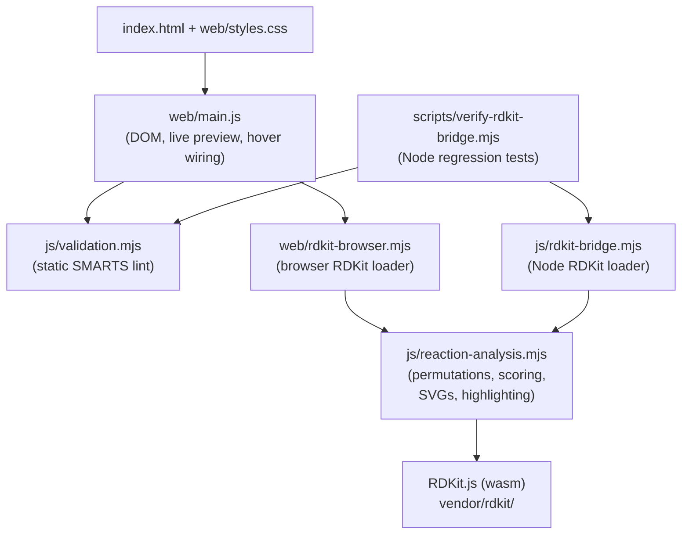

# SMARTSLOP
SMARTS Linter and Outcome Predictor - a browser tool for validating reaction SMARTS templates and scoring their predicted outcomes against expected products.

## What it does

Given a set of reactant SMILES, one or more expected product SMILES, and a reaction SMARTS template, SMARTSLOP:

1. **Lints** the reaction SMARTS before any RDKit call. Specifically it:
   - Rejects empty input and templates missing the `>>` separator.
   - Rejects templates with an empty reactant or product side.
   - Warns when the template has no atom maps at all (unmapped templates almost always generate unrelated products).
   - Warns when a `:n` atom map appears on the product side but not the reactant side (RDKit will invent a new atom).
   - Warns when a `:n` atom map appears on the reactant side but not the product side (the atom will be dropped from every generated product).
   - Warns when a SMILES input has extra lines.
   Errors block evaluation; warnings surface next to the run controls.
2. **Renders reactants and expected products live** with the atoms and bonds that bind to the SMARTS fragments highlighted in orange, updating on every keystroke.
3. **Enumerates outcomes** with RDKit's `run_reactants` across every reactant permutation, canonicalises the resulting products, and dedupes by product multiset.
4. **Scores outcomes** against the expected products: exact match, partial match, or no match, with a percentage score and per-outcome breakdown.
5. **Balance-checks** heavy atoms between reactants and expected products, and reports directional imbalance ("N atoms on the reactant side with no matching product atom - missing byproducts?" vs. the equivalent for the product side).
6. **Cross-highlights mapped atoms on hover** - hovering an atom that is part of a `:n` atom map lights up every other occurrence of that map number across reactants, target products, and generated outcomes.

Everything runs client-side. There is no server and no build step.

## Running it

```bash
# Install deps (only @rdkit/rdkit, for the Node-side verify harness)
npm install

# Node-side regression harness - runs the same analysis pipeline against
# a handful of canonical reactions and asserts on the results.
npm run verify:rdkit-bridge
```

To open the app, serve the repository root over HTTP and open `index.html`.
Any static file server works, for example:

```bash
python3 -m http.server 8080
# then open http://127.0.0.1:8080/index.html
```

VS Code's Live Preview extension also works out of the box.

## Input format

The reactant and expected-product textareas take **one SMILES per line**. An optional label follows the first whitespace on the line:

```
COC=CC(=C)O[Si](C)(C)C Danishefsky's diene
O=C1C=CC(=O)C=C1 p-benzoquinone
```

Labels show up in the reaction diagram cells and outcome table. SMILES fragments joined by `.` are treated as a single multi-component molecule (which is what `.` means in SMILES).

The reaction SMARTS field expects a standard atom-mapped SMARTS in the form `reactants>>products`, e.g.

```
[C:1]=[C:2][C:3]=[C:4].[C:5]=[C:6]>>[C:1]1[C:2]=[C:3][C:4][C:5][C:6]1
```

Atom mapping is optional but strongly recommended - the linter uses it to detect dropped or newly introduced atoms, and the hover indexer uses it to trace atoms across the reaction.

## Architecture



- [js/validation.mjs](js/validation.mjs) - static linter for reaction SMARTS. No RDKit dependency.
- [js/reaction-analysis.mjs](js/reaction-analysis.mjs) - the RDKit-facing analysis module. Shared by the browser and the Node verify harness.
- [js/rdkit-bridge.mjs](js/rdkit-bridge.mjs) - Node-side RDKit loader (uses the `@rdkit/rdkit` npm package).
- [web/main.js](web/main.js) - browser glue: input parsing, debounced live preview, submit handling, DOM rendering, and cross-atom hover wiring.
- [web/rdkit-browser.mjs](web/rdkit-browser.mjs) - browser-side RDKit loader (uses the vendored `vendor/rdkit/RDKit_minimal.js` bundle).
- [scripts/verify-rdkit-bridge.mjs](scripts/verify-rdkit-bridge.mjs) - Node harness that runs six assertions covering exact match, permutation ordering, off-target detection, heavy-atom balance, and the two static-lint code paths.

## License

See [LICENSE](LICENSE).
