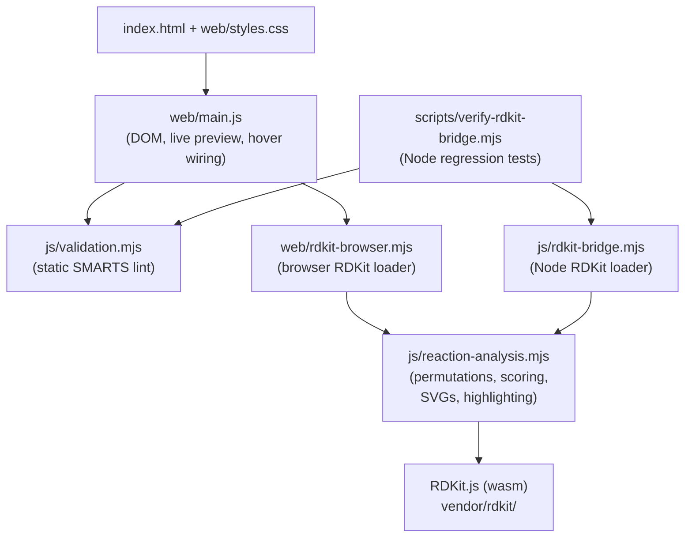

# SMARTSLOP

SMARTS Linter and Outcome Predictor. A browser tool that checks reaction SMARTS templates and that compares the predicted products to the expected products.

## What the app does

Give the app three inputs:

- One or more reactant SMILES.
- One or more expected product SMILES.
- A reaction SMARTS template.

The app then does these steps.

1. **Lint the reaction SMARTS.** The app examines the SMARTS string before it calls RDKit. Specifically:
   - The app rejects an empty input.
   - The app rejects a template that does not have the `>>` separator.
   - The app rejects a template with an empty reactant side or an empty product side.
   - The app gives a warning if the template has no atom map. An unmapped template almost always makes an unrelated product.
   - The app gives a warning if a `:n` atom map is on the product side only. RDKit treats such an atom as a new atom.
   - The app gives a warning if a `:n` atom map is on the reactant side only. RDKit removes such an atom from each generated product.
   - The app gives a warning if a SMILES input has more than one line.

   An error blocks the run. A warning shows next to the run controls, but does not block the run.
2. **Draw each mol as you type.** The app draws each reactant and each expected product. Each keystroke updates the drawing. The atoms and bonds that match the SMARTS fragments are orange.
3. **Get the outcomes.** The app calls `run_reactants` from RDKit for each permutation of the reactants. The app then makes each product canonical. The app removes duplicate outcomes by product multiset.
4. **Score the outcomes.** The app compares each outcome to the expected products. Each outcome gets one of three verdicts: exact match, partial match, or no match. Each outcome also gets a percentage score.
5. **Check the atom balance.** The app counts the heavy atoms on each side. If the counts do not match, the app shows a warning. The warning gives the direction of the imbalance. Extra atoms on the reactant side mean that a byproduct is missing. Extra atoms on the product side mean that a co-reagent is missing.
6. **Trace mapped atoms on hover.** Hover an atom that has a `:n` atom map. The app then highlights each other atom with the same map number. This works for the reactants, for the expected products, and for the generated outcomes.

The app runs in the browser only. There is no server. There is no build step.

## How to run the app

Install the dependencies. The only dependency is `@rdkit/rdkit`. The Node check harness uses it.

```bash
npm install
```

Run the check harness. The harness runs the same analysis pipeline for some standard reactions and asserts on the results.

```bash
npm run verify:rdkit-bridge
```

To open the app, serve the repository root over HTTP. Then open `index.html`. Any static file server is sufficient. For example:

```bash
python3 -m http.server 8080
# then open http://127.0.0.1:8080/index.html
```


## Input format

The reactant textarea and the expected-product textarea each take one SMILES per line. An optional label follows the first whitespace on the line.

```
COC=CC(=C)O[Si](C)(C)C Danishefsky's diene
O=C1C=CC(=O)C=C1 p-benzoquinone
```

The label shows in the reaction diagram cell and in the outcome table. A SMILES with a `.` between fragments is one multi-component mol. This is the standard meaning of `.` in SMILES.

The reaction SMARTS field takes an atom-mapped SMARTS in the form `reactants>>products`. For example:

```
[C:1]=[C:2][C:3]=[C:4].[C:5]=[C:6]>>[C:1]1[C:2]=[C:3][C:4][C:5][C:6]1
```

An atom map is optional, but we recommend that you use one. The linter uses the atom maps to detect a dropped atom or a new atom. The hover indexer uses the atom maps to trace an atom across the reaction.

## Architecture



- [js/validation.mjs](js/validation.mjs) - The static linter for reaction SMARTS. This file does not call RDKit.
- [js/reaction-analysis.mjs](js/reaction-analysis.mjs) - The RDKit-facing analysis module. The browser and the Node check harness both use this file.
- [js/rdkit-bridge.mjs](js/rdkit-bridge.mjs) - The Node-side RDKit loader. It uses the `@rdkit/rdkit` npm package.
- [web/main.js](web/main.js) - The browser glue. It parses the input, debounces the live preview, handles the submit, renders the DOM, and wires the hover.
- [web/rdkit-browser.mjs](web/rdkit-browser.mjs) - The browser-side RDKit loader. It uses the `vendor/rdkit/RDKit_minimal.js` bundle from the vendor directory.
- [scripts/verify-rdkit-bridge.mjs](scripts/verify-rdkit-bridge.mjs) - The Node check harness. It runs six assertions. The assertions cover exact match, permutation order, off-target detection, heavy-atom balance, and the two static-lint code paths.

## RDKit.js features that this app uses

The [RDKit.js documentation](https://www.rdkitjs.com/) does not list every function that this app uses. Use this section as help when you change [js/reaction-analysis.mjs](js/reaction-analysis.mjs) or [web/rdkit-browser.mjs](web/rdkit-browser.mjs).

Each subsection has a documentation-status marker:

- **Documented** - The rdkitjs.com pages describe the call and its arguments.
- **Partially documented** - The rdkitjs.com pages show the call, but do not describe part of the input or the output.
- **Undocumented** - The rdkitjs.com pages do not mention the call.

Warning: These calls are stable in RDKit.js 2025.03.x, but some of them are not part of a specified public contract. A subsequent release can change the behavior.

### Parse a SMARTS query

> **Status: Partially documented.** The [Substructure Highlighting page](https://www.rdkitjs.com/#/drawing-molecules/substructure-highlighting) shows the call in one example. The query-mol type and its lifecycle are not described.

Call `RDKitModule.get_qmol(smartsString)`. The result is a query mol. Give the query mol as the argument to `mol.get_substruct_match(qmol)`. Call `qmol.delete()` when you have completed the operation.

### Find a substructure match

> **Status: Partially documented.** The [Substructure Highlighting page](https://www.rdkitjs.com/#/drawing-molecules/substructure-highlighting) shows the call as an opaque argument to `draw_to_canvas_with_highlights`. The return schema, and the query-atom order of the `atoms` array, are not described.

Call `mol.get_substruct_match(qmol)`. The result is a JSON string. Parse the string to get an object with two fields.

- `atoms` - An array of atom indices in the mol. The array is in the same order as the query atoms. Use the array to map SMARTS atom-map numbers to mol atom indices.
- `bonds` - An array of bond indices in the mol.

If the query does not match, the result is `""` or an object with an empty `atoms` array.

### Render a 2D depiction with highlights

> **Status: Partially documented.** The [Substructure Highlighting page](https://www.rdkitjs.com/#/drawing-molecules/substructure-highlighting) describes the `atoms`, `bonds`, `width`, `height`, `legend`, and `bondLineWidth` fields. The `highlightAtomColors` field, the `highlightBondColors` field, and the CSS class hooks in the output SVG (see below) are not on that page.

Call `mol.get_svg_with_highlights(jsonString)`. The JSON string has these fields.

- `atoms` - An array of atom indices to highlight. **Documented.**
- `bonds` - An array of bond indices to highlight. **Documented.**
- `highlightAtomColors` - An object. Each key is an atom index. Each value is an array of three numbers, `[r, g, b]`, in the 0.0 to 1.0 range. **Undocumented.**
- `highlightBondColors` - The same shape as `highlightAtomColors`, but the keys are bond indices. **Undocumented.**
- `width` - The SVG width in pixels. **Documented.**
- `height` - The SVG height in pixels. **Documented.**
- `bondLineWidth` - The bond stroke width in SVG units. **Documented.**

The output SVG has DOM elements that you can find by CSS class. **These class hooks are undocumented.**

- Each highlighted atom has an `<ellipse class="atom-N">` element. `N` is the atom index in the mol.
- Each highlighted bond has a `<path class="bond-N">` element.

An atom without a highlight and without an element symbol gets no element in the SVG. For this reason, this app puts a hover target only on a highlighted atom.

### Get an atom-level JSON dump

> **Status: Undocumented.** The rdkitjs.com pages do not mention `get_json`. The CommonChem format is described at [the CommonChem specification](https://github.com/CommonChem/CommonChem).

Call `mol.get_json()`. The result is a JSON string in the CommonChem format. Four fields are necessary for atom counting.

- `defaults.atom.z` - The default atomic number for an atom that does not set its own atomic number.
- `defaults.atom.impHs` - The default implicit hydrogen count.
- `molecules[i].atoms[j].z` - The atomic number for atom `j` in molecule `i`.
- `molecules[i].atoms[j].impHs` - The implicit hydrogen count for atom `j` in molecule `i`.

This app uses these fields to compute a molecular formula without a second RDKit call.

### Run a reaction

> **Status: Undocumented.** The rdkitjs.com pages do not mention `get_rxn`, `MolList`, `append`, `run_reactants`, `.size()`, `.get()`, or `.at()`.

Call `RDKitModule.get_rxn(reactionSmarts)` to make a reaction object. To run the reaction, do these steps.

1. Make a `new RDKitModule.MolList()` object.
2. For each reactant mol, call `molList.append(mol)`. The order must match the reactant template order on the left side of the SMARTS `>>` separator.
3. Call `reaction.run_reactants(molList)`. The result is an outcome-set list.
4. Call `.size()` on the outcome-set list to get the count.
5. Call `.get(i)` to get the product list for outcome set `i`.
6. Call `.size()` and `.at(j)` on each product list to get product mol `j`.
7. Call `.delete()` on each product mol, on each product list, on the outcome-set list, and on the MolList.

Warning: If the reactant order does not match the SMARTS reactant order, `run_reactants` gives no outcome. To find each valid outcome, try each permutation of the reactant order. The function `collectOutcomes` in [js/reaction-analysis.mjs](js/reaction-analysis.mjs) does this.

Warning: `run_reactants` gives the products in a raw form. The SMILES can contain atom-map data or bond information that does not survive canonicalization. Re-parse each product SMILES through `RDKitModule.get_mol(rawSmiles).get_smiles()` to get a canonical form. The function `sanitizeGeneratedProduct` in [js/reaction-analysis.mjs](js/reaction-analysis.mjs) does this.

### Release the wasm memory

> **Status: Undocumented.** The rdkitjs.com pages do not mention `.delete()` or the memory model.

Each mol, qmol, MolList, product list, and outcome-set list has a `.delete()` method. Call `.delete()` on each object when you have completed the operation. Put the `.delete()` call in a `finally` block. This makes sure that an error in the `try` block does not skip the release.

Warning: If you do not call `.delete()`, the wasm heap does not release the memory. In a long browser session this causes an out-of-memory error.

### Get the RDKit version

> **Status: Undocumented.** The rdkitjs.com pages do not mention `RDKitModule.version()`.

Call `RDKitModule.version()`. The result is a string. For example, `2025.03.1`.

## License

See [LICENSE](LICENSE).
